# unclawdesign

**Every website gets its own face.** unclawdesign is an agent skill for Claude (and other coding
agents that read Agent Skills) that designs, builds and critiques web pages from a rolled design
genome: the page's experience, a design paradigm, a palette, a font pair and 14 visual genes, drawn
from curated libraries. Ask twice and you get two finished, different directions.

<p align="center">
  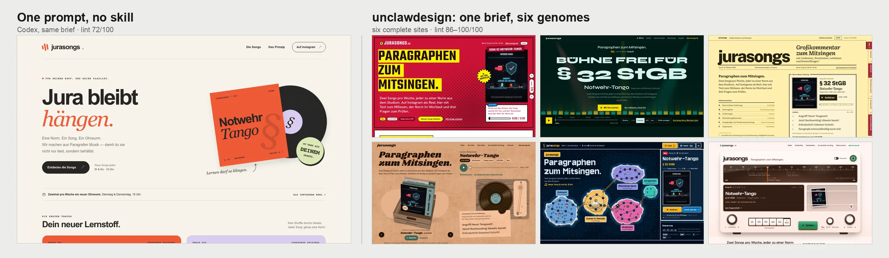
</p>

[Install](#install) · [The problem](#the-problem-ai-pages-converge) ·
[Case study: jurasongs.de](#case-study-jurasongsde-one-brief-six-sites) ·
[Showcase: Tidewater Roasters](#showcase-tidewater-roasters) · [How it works](#how-it-works) ·
[Teach it your brand](#teach-it-your-brand-roadmap) · [Repository](#repository)

## Install

The skill is the folder [`unclawdesign/`](unclawdesign/) (1.5 MB: `SKILL.md`, libraries, scripts,
references). Its scripts need Python 3 and nothing else (`getfont.py` additionally uses
`pip install fonttools brotli`). This repository is private, so clone it with access to
`Tonvenio`:

```bash
gh repo clone Tonvenio/skills-unclawdesign ~/GitHub/skills-unclawdesign
```

| Environment | Where the skill lives | How to start it |
| --- | --- | --- |
| **Claude Code** (terminal, desktop app, VS Code, JetBrains) | `~/.claude/skills/unclawdesign/` for you, `.claude/skills/unclawdesign/` in a repo for your team | `/unclawdesign`, or ask for a page |
| **claude.ai** and the Claude apps | uploaded `.skill` package | ask for a page in any chat |
| **Claude API** | Skills API (`/v1/skills`) | `container.skills` plus code execution |
| **Claude Agent SDK** | `~/.claude/skills/` or `.claude/skills/` | `setting_sources=["user", "project"]` |
| **Codex** (CLI, IDE extension, app) | `~/.agents/skills/unclawdesign/` or `.agents/skills/unclawdesign/` in a repo | `$unclawdesign`, or ask for a page |
| **Any other agent that reads Agent Skills** | its skills folder | copy the folder as it is |

<details open>
<summary><b>Claude Code</b></summary>

```bash
mkdir -p ~/.claude/skills
ln -s ~/GitHub/skills-unclawdesign/unclawdesign ~/.claude/skills/unclawdesign      # personal
cp -R ~/GitHub/skills-unclawdesign/unclawdesign <project>/.claude/skills/          # shared with a team via the project repo
```

The link keeps the skill current with `git pull`. On Marc's Macs, `~/.claude/skills` points into
`claude-config/skills`, so the link goes there instead and syncs to both Macs:
`ln -s ../../skills-unclawdesign/unclawdesign ~/GitHub/claude-config/skills/unclawdesign`.
The roll history lives in `~/.unclawdesign/` and persists across sessions, which feeds the variety rules.
</details>

<details>
<summary><b>claude.ai, Claude desktop and mobile apps</b></summary>

```bash
./tools/package.sh          # writes dist/unclawdesign.skill (a zip with unclawdesign/ at its root)
```

Upload `dist/unclawdesign.skill` under **Settings → Capabilities → Skills**. Code execution must be
enabled there, because the skill runs its Python scripts in Claude's sandbox. The package carries all
data, scripts and references. In claude.ai the roll history resets with every conversation; the
randomness still keeps runs apart.
</details>

<details>
<summary><b>Claude API</b></summary>

Upload once, then attach the skill to any request that has code execution:

```python
import anthropic
from anthropic.lib import files_from_dir

client = anthropic.Anthropic()
skill = client.skills.create(files=files_from_dir("unclawdesign"))   # keep skill.id

with client.beta.messages.stream(
    model="claude-opus-5-5",
    max_tokens=64000,
    output_config={"effort": "high"},
    betas=["code-execution-2025-08-25"],
    container={"skills": [{"type": "custom", "skill_id": skill.id, "version": "latest"}]},
    tools=[{"type": "code_execution_20260521", "name": "code_execution"}],
    messages=[{"role": "user", "content": "Design the homepage for a coffee roastery. Use unclawdesign."}],
) as stream:
    message = stream.get_final_message()
```

Files the skill writes in the container (the page, `tokens.css`) come back as file IDs; download them
with the Files API. Limits: 30 MB per skill (this one has 1.5 MB), up to 20 skills per request.
Reference: [Skills guide](https://platform.claude.com/docs/en/build-with-claude/skills-guide).
</details>

<details>
<summary><b>Claude Agent SDK</b></summary>

Put the folder into `.claude/skills/` of the project the agent works in (or `~/.claude/skills/`),
then load the filesystem sources:

```python
from claude_agent_sdk import query, ClaudeAgentOptions

options = ClaudeAgentOptions(
    cwd="/path/to/project",                # .claude/skills/unclawdesign/ here or in a parent
    setting_sources=["user", "project"],   # loads skills from the filesystem
    skills=["unclawdesign"],
    allowed_tools=["Read", "Write", "Edit", "Bash"],
)
async for message in query(prompt="Design a landing page for our product launch", options=options):
    print(message)
```

Reference: [Agent SDK skills](https://code.claude.com/docs/en/agent-sdk/skills).
</details>

<details>
<summary><b>Codex</b></summary>

```bash
mkdir -p ~/.agents/skills
ln -s ~/GitHub/skills-unclawdesign/unclawdesign ~/.agents/skills/unclawdesign       # personal
cp -R ~/GitHub/skills-unclawdesign/unclawdesign <repo>/.agents/skills/              # per repository
```

Codex picks up new skills automatically; restart it if the skill does not appear. The process in
`SKILL.md` is model-neutral. The sections about claude.ai artifacts apply only there.
Reference: [Codex skills](https://developers.openai.com/codex/skills).
</details>

## The problem: AI pages converge

Ask a model for "a homepage" and it reaches for the most probable tasteful answer. Asked a hundred
times, it returns the same few looks:

- **The Claude look:** warm cream ground, high-contrast serif, a terracotta accent, tracked ALL-CAPS
  eyebrows, one italic word in the headline, cards numbered 01 / 02 / 03, a stats row, a fade-up on
  every section.
- **The vibe-coded look:** blue-to-purple gradients and glow blobs, Inter everywhere, a centered hero
  with a pill badge and two buttons, three identical feature cards with emoji icons, "Get started".
- **The skeleton underneath both:** hero, features, social proof, pricing, FAQ, footer, each with the
  same weight. Even a perfect palette reads as a template on this structure.

Here is the jurasongs.de brief given to a model as one prompt, with no skill:

<p align="center">
  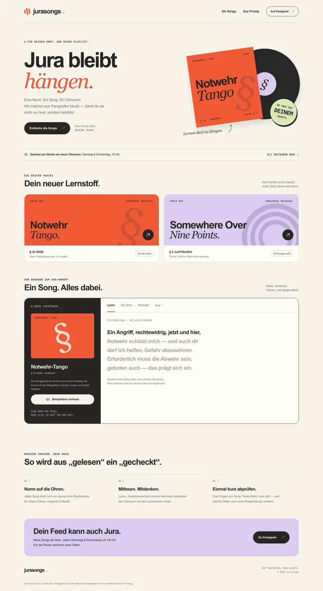
</p>

Codex with its default model, one prompt, no skill, 11 October 2026 (the page is in
[`docs/readme/baseline-codex.html`](docs/readme/baseline-codex.html)). It is polished, and it is
assembled entirely from the defaults: cream paper with an orange accent, one italic word in the
headline ("hängen."), tracked monospace eyebrows, an arrow on every button, steps numbered 01 / 02 / 03,
and the hero, cards, feature, steps, call-to-action skeleton. `lint_design.py` gives it 72/100 with six
findings. A different vendor's model landed on the Claude look described above: the default has spread
across vendors.

<details>
<summary>The prompt</summary>

> Design and build the homepage for jurasongs.de as a single self-contained HTML file with inline CSS
> and JavaScript (no external images). jurasongs publishes songs for German law students: two new songs
> per week (Tuesday and Thursday, 6 pm), each song about exactly one legal norm (e.g. § 32 StGB,
> self-defence), released as an Instagram reel. On the website you can listen, read the lyrics while
> they are sung, see the norm's wording, a mnemonic and three quiz questions. Current songs:
> 'Notwehr-Tango' (§ 32 StGB, criminal law) and 'Somewhere Over Nine Points' (§ 2 JurPrNotSkV, exam
> grading). The site is in German. Reply with the complete HTML only.
</details>

unclawdesign treats design as a search over a large, curated space. The catalogue of these defaults
([`references/anti-patterns.md`](unclawdesign/references/anti-patterns.md)) is built into the process,
and [`lint_design.py`](unclawdesign/scripts/lint_design.py) checks every page for them before
delivery.

## Case study: jurasongs.de, one brief, six sites

[jurasongs.de](https://jurasongs.de) publishes songs for German law students: two per week, each
about one legal norm, with sung-along lyrics, the norm's wording, a mnemonic and a quiz. The skill
rolled six genomes that differ on every axis and built six complete sites (home page and song page)
on the live site's own data:

<table>
<tr>
<td width="50%">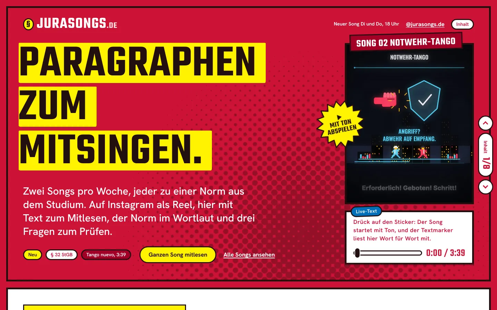<br>
<b>Reel feed</b> · scroll comic × pop colour block × Wada 154 × Teko/Hanken Grotesk<br>
Every screen is a comic panel born from the Instagram reel, with Ben-Day dots and stickers; the
yellow highlighter from the video sings the claim word by word.</td>
<td width="50%">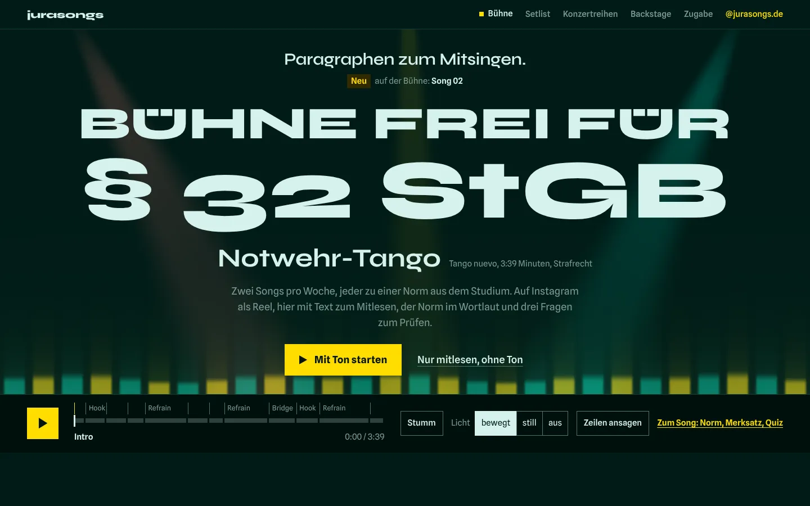<br>
<b>Karaoke stage</b> · audio-reactive × kinetic typography × Wada 284 × Syne/Spline Sans, dark<br>
The current line stands huge on stage and each word fills in as it is sung, while the stage lights
breathe with the song.</td>
</tr>
<tr>
<td>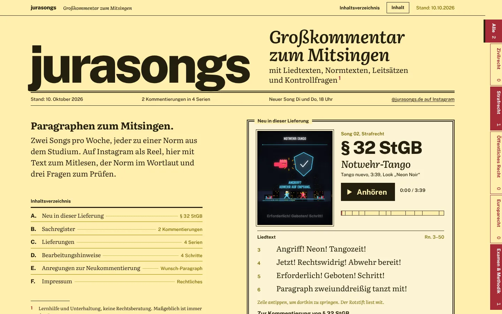<br>
<b>Grand commentary</b> · digital archive × broadsheet × Wada 228 × Public Sans/Literata<br>
A loose-leaf legal commentary with margin numbers and an index, taken completely seriously; the
examiner's red pen underlines the sung word live.</td>
<td>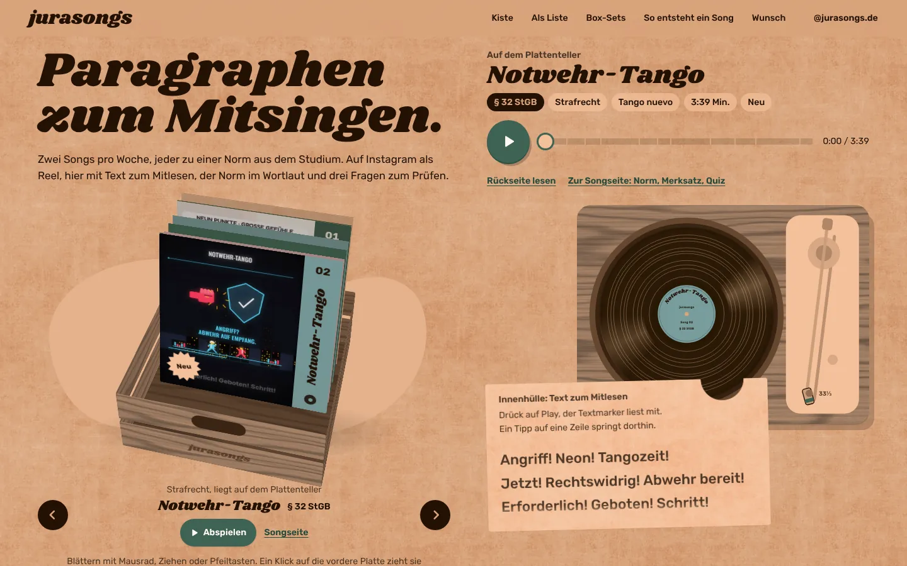<br>
<b>Record crate</b> · explorable 3D scene × mid-century modern × Wada 223 × Shrikhand/Rubik<br>
Flip through a wooden crate, pull a record, put it on the turntable; the tone arm travels with the
song while the inner sleeve marks the lyrics.</td>
</tr>
<tr>
<td>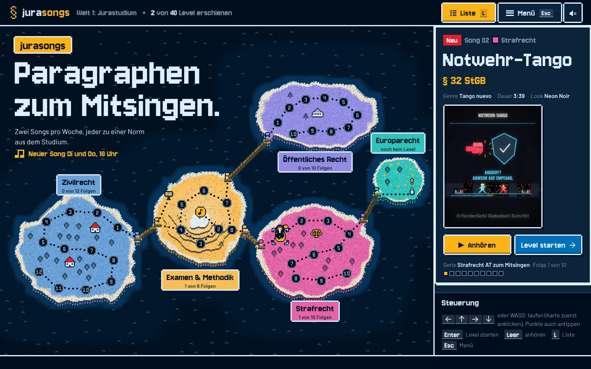<br>
<b>Exam world map</b> · playable game × 8-bit pixel × Wada 257 × Chakra Petch/Barlow, dark<br>
Law school as a 16-bit world map: one island per field of law, every song a level, the quiz a boss
fight against "Die Klausur".</td>
<td>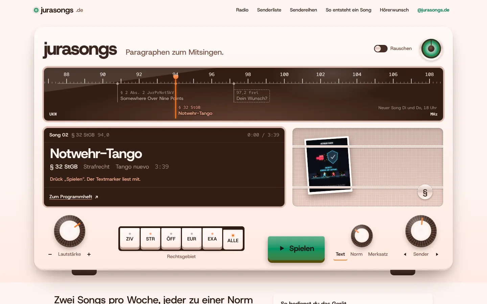<br>
<b>Radio dial</b> · cursor instrument × tactile skeuomorphism × Wada 256 × Host Grotesk/Red Hat Mono<br>
Every song is a station on a 1950s glass dial: turn the knob, hear the static, and the lyrics run
in the display once the magic eye closes.</td>
</tr>
</table>

<p align="center">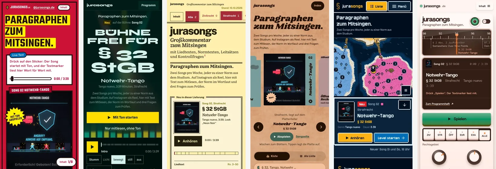</p>

All six share one small core (data with corrected paths, the media player, word timing), so each
variant only designs. Each has a designed phone version and a calm version for
`prefers-reduced-motion`, uses no framework and self-hosts its fonts. The skill's linter scores them
between 86 and 100 out of 100, three of them without a single finding (the one-prompt page: 72). The variants live in
[`Tonvenio/jurasongs`](https://github.com/Tonvenio/jurasongs) under `variants/`, next to a picker page
that compares them.

## Showcase: Tidewater Roasters

A fictional coffee roastery, built once as six switchable style directions and once as six
experiences beyond the landing page. Every image and video in it is generated in code.

<table>
<tr>
<td width="33%">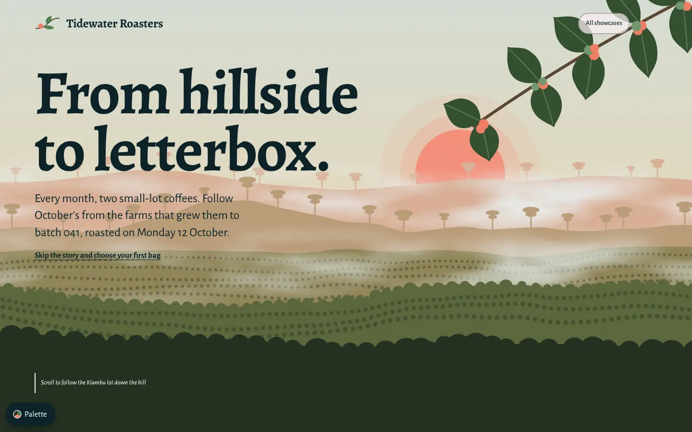<br><b>Cherry to Cup</b><br>parallax scrollytelling</td>
<td width="33%">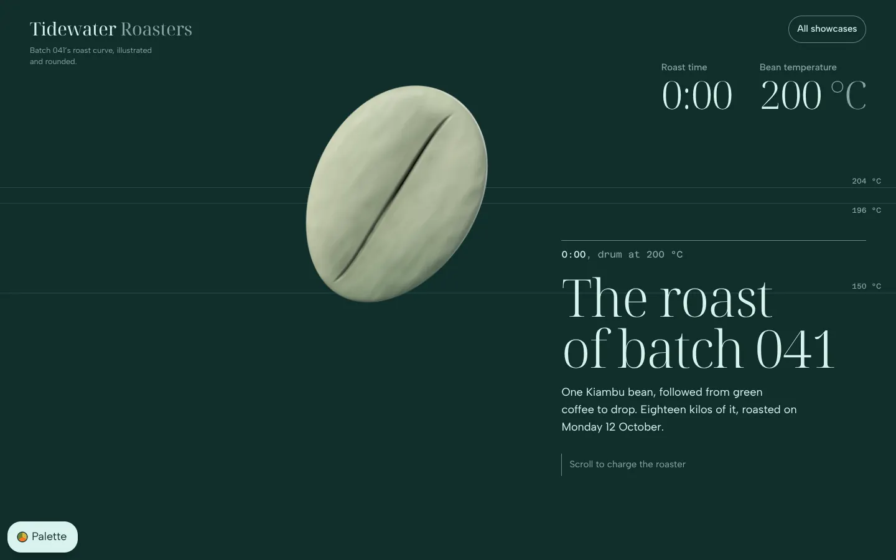<br><b>The Roast</b><br>scroll-scrubbed sequence</td>
<td width="33%">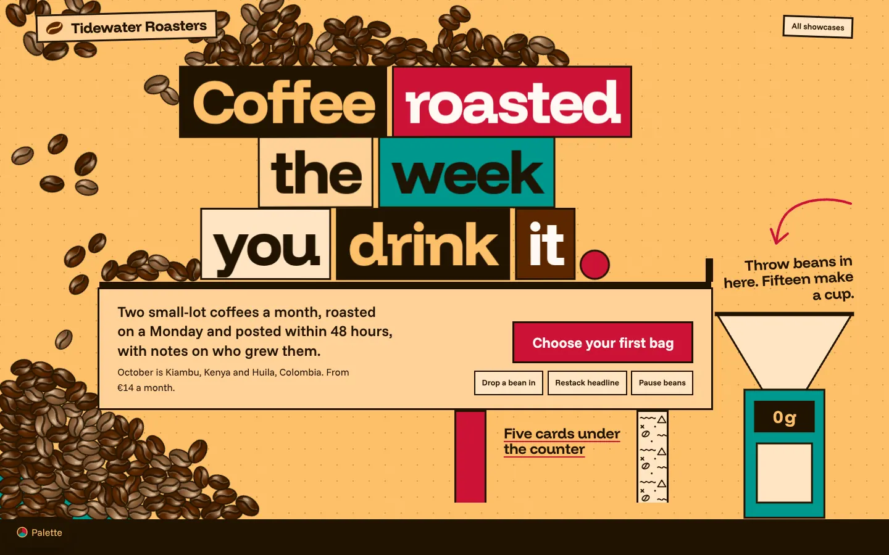<br><b>Bean Box</b><br>physics playground</td>
</tr>
<tr>
<td>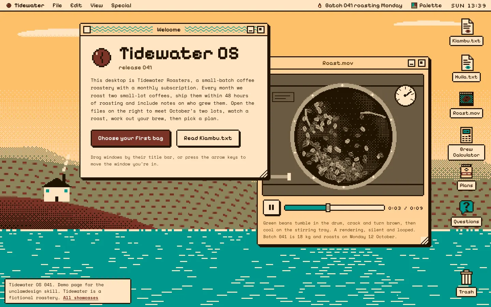<br><b>Tidewater OS</b><br>OS desktop</td>
<td>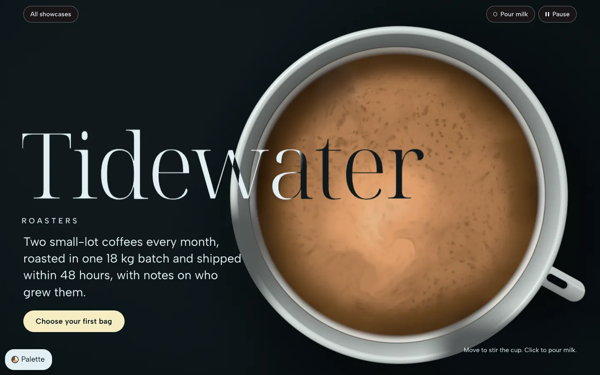<br><b>Crema</b><br>WebGL liquid</td>
<td>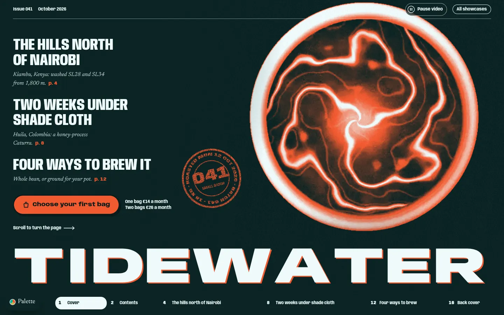<br><b>Issue 041</b><br>horizontal magazine</td>
</tr>
</table>

<p align="center">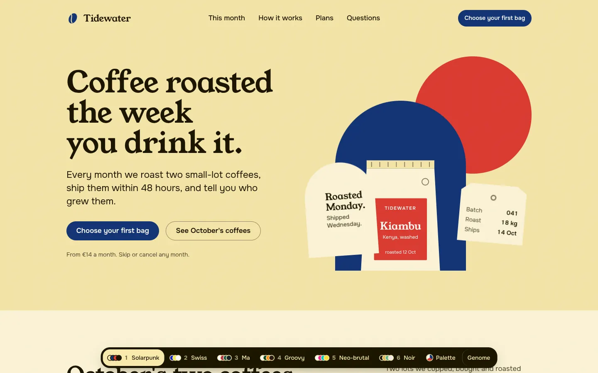<br>
Six directions, one page: Solarpunk, Swiss, Japanese ma, 70s groovy, neo-brutalism and dark luxury,
switchable live.</p>

Open it locally with `cd showcase && python3 -m http.server 8799 --bind 127.0.0.1`
(<http://127.0.0.1:8799/>).

## How it works

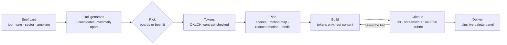

**1. The brief card.** The skill reads the request into subject and audience, job (conversion,
brand, editorial, portfolio, product UI, dashboard, docs, event, ecommerce), the one action the page
must drive, three to five tone words, the sector, the ambition (classic, standard, experiential) and
fixed constraints such as brand colours or required content.

**2. The genome.** [`roll.py`](unclawdesign/scripts/roll.py) draws candidates from the libraries,
weights them by fit to the brief, then keeps the set that differs most from each other and from
recent runs:

| Dimension | Library | Examples |
| --- | --- | --- |
| Experience (structure and interaction) | 20 archetypes | classic landing, parallax scrollytelling, physics playground, OS desktop, playable game, radio dial |
| Paradigm | 41 design paradigms | Swiss, Bauhaus, Memphis, Riso, Solarpunk, Terminal, Dark Luxury |
| Palette | 54 generated + 348 by Sanzo Wada | each as light, dark and colour ground in OKLCH |
| Font pair | 77 Google Fonts pairs + 11 Fontshare pairs | 16 mood clusters, every family verified against Google's metadata |
| Visual genes | 14 genes | shape, edge, elevation, texture, hero, grid, motif, imagery, icons, motion, density, align, scale, colour use |

The four large dimensions alone give about 29 million combinations before the genes. A genome looks
like this (the reel feed above):

```json
{ "experience": "scroll-comic", "paradigm": "pop-color-block", "palette": "wada-154", "variant": "color",
  "fonts": "teko-hanken", "shape": "pill-controls", "edge": "thick-ink", "elevation": "flat",
  "texture": "halftone", "hero": "full-bleed-image", "grid": "alternating-bands", "motif": "sticker",
  "imagery": "cutout-photo", "motion": "kinetic-type", "density": "balanced", "align": "centered" }
```

Locks keep what the brief fixes (`--experience`, `--paradigm`, `--palette`, `--fonts`), `--wild 0–3`
sets how surprising the roll may be, and `--avoid` steers "another version" away from the last one.

**3. Tokens.** [`tokens.py`](unclawdesign/scripts/tokens.py) turns the genome into one stylesheet:
colours for both modes, font stacks and display treatment, a fluid type scale, spacing, radii,
borders, shadows, motion tokens and a base layer. Every text pair passes WCAG (body text ≥ 7:1, muted
≥ 4.5:1, accent ≥ 3:1). The page uses tokens only, which is also what makes the live palette panel
possible: 348 Wada combinations or your own colours, switched in the browser without a rebuild.

**4. Plan and build.** Scenes in order, wireframes for desktop and 390 px, one signature move, a
motion map with one orchestrated entrance, a designed reduced-motion version, a media plan (missing
assets are generated in code: loops, frame sequences, noise, shaders) and a list of the defaults
this brief would tempt. Performance budgets: LCP ≤ 2.5 s, INP ≤ 200 ms, CLS ≤ 0.1. For real sites the
fonts are self-hosted, which matters for GDPR in the EU.

**5. Critique.** The linter flags AI tells and quality-floor misses, screenshots at 1440 and 390 px
go back to the model, and a 39-point rubric must reach 28 with no zero before delivery.

## Teach it your brand (roadmap)

**Available today.** The skill already respects a brand when you bring it:

- Brand colours: `colorlib.py brand "#hex"` or `colorlib.py combo "#a" "#b" "#c"` builds a
  contrast-safe token set around the exact colours.
- Brand fonts stay locked; the roll then covers experience, paradigm and genes.
- An existing design system keeps its components; the genome adds composition, motif, imagery and
  rhythm.

**Planned: an onboarding that learns your company.** The aim is a skill that knows your CI after one
conversation and still surprises you on the hundredth page.

1. **Onboarding interview.** On first use (`roll.py onboard`), the skill asks a short set of
   questions: company, audience, three adjectives, sites you admire, sites you dislike, hard no-gos,
   legal constraints (accessibility level, GDPR fonts).
2. **CI ingestion.** It reads what exists: a brand-guideline PDF, logo files, the current website
   (colours, fonts, radii and spacing extracted from its CSS and screenshots) and a tone-of-voice
   document. The result is a brand profile with hard rules and soft preferences:

   ```json
   {
     "brand": "acme",
     "locked":   { "colors": ["#0F3D3E", "#F2A541", "#E9E4DA"],
                   "fonts": { "display": "Acme Sans", "body": "Acme Text", "files": "brand/fonts/" },
                   "logo": "brand/logo.svg", "min_contrast": "AAA" },
     "prefer":   { "paradigms": { "swiss-international": 1.4, "editorial-magazine": 1.2 }, "density": "airy" },
     "avoid":    { "paradigms": ["memphis", "pixel-8bit"], "tells": ["gradient-text"] },
     "variety":  { "free": ["experience", "grid", "motif", "imagery", "motion", "hero"], "wild": 1.0 }
   }
   ```

3. **Learning from choices.** Every pick, rejection and "more like this" on a direction board
   adjusts the weights in the profile, the way the roll history already penalises repeats today.
4. **Team profiles.** A profile checked into a repository (`.unclawdesign/brand.json`) gives everyone
   on a team the same CI; a personal profile in `~/.unclawdesign/brands/` covers freelancers with
   several clients (`roll.py --brand acme`).

**Variety inside the guardrails.** The profile narrows the space; the roll keeps moving inside it.
Colours and type come from the brand, while experience, layout, motif, imagery and motion still roll,
candidates are still pushed apart, and recent genomes are still penalised. Three pages for the same
brand can become a parallax journey, a magazine and a configurator, each recognisably on-brand.

## Repository

| Path | What it is |
| --- | --- |
| `unclawdesign/` | The skill: `SKILL.md`, `data/` (libraries), `scripts/` (genome engine, tokens, boards, colour library, linter, screenshots, font helper), `references/`, `assets/` (palette engine and customizer) |
| `showcase/` | Tidewater Roasters: six switchable directions and six experience pages (`x/journey`, `x/roast`, `x/playground`, `x/os`, `x/crema`, `x/issue`), gallery at `showcase/index.html` |
| `build/` | Regenerates the libraries in `unclawdesign/data/` (font verification against google/fonts, palette and Wada builds, paradigms and genes) |
| `docs/` | Research report "Creative web beyond landing pages" behind the experience layer; `docs/readme/` holds the images of this page |
| `tools/` | `package.sh` packs the skill into `dist/unclawdesign.skill`; `build_customizer.py` rebuilds the palette panel |

The real-site application (six jurasongs.de variants) lives in
[`Tonvenio/jurasongs`](https://github.com/Tonvenio/jurasongs) under `variants/`.

### How to run

The skill has no server; its scripts are command-line tools. Run them from the skill folder:

```bash
cd unclawdesign
python3 scripts/roll.py --job brand --tone "warm,crafted" --sector "coffee roastery" --count 3
python3 scripts/roll.py css 1 -o tokens.css      # token stylesheet for candidate 1
python3 scripts/roll.py list experiences         # browse any library
python3 scripts/lint_design.py page.html         # AI-tell and quality check
python3 scripts/roll.py check                    # validate the experience library
```

The roll history lives in `~/.unclawdesign/` (override with `UNCLAW_HOME`).

**Showcase** (static files only):

- Locally: `cd showcase && python3 -m http.server 8799 --bind 127.0.0.1`, then
  <http://127.0.0.1:8799/>. Stop with Ctrl-C.
- On the tailnet: double-click `showcase/serve.command` (port 8787, bound to the Tailscale
  address). Stop with `pkill -f 'http.server 8787'`.

Check the port first with `lsof -nP -iTCP:<port> -sTCP:LISTEN`.

**Rebuilding the libraries** (rarely needed; writes into `unclawdesign/data/`):

```bash
python3 build/paradigms_src.py        # paradigms.json + genes.json
python3 build/build_fonts.py          # fonts.json, verifies every family against google/fonts
python3 build/build_palettes.py       # palettes.json
python3 build/build_wada.py           # palettes-wada.json + wada-combos.json
python3 tools/build_customizer.py     # re-inject the Wada data into assets/customizer.js
python3 unclawdesign/scripts/roll.py check
```

`assets/customizer.js` is generated from `assets/customizer.src.js`; edit the source file and
rebuild.

## Credits

Wada colour data: Sanzo Wada, *A Dictionary of Color Combinations* (Seigensha), digitised in
[mattdesl/dictionary-of-colour-combinations](https://github.com/mattdesl/dictionary-of-colour-combinations)
(MIT, licence in `build/wada/`). Fonts: Google Fonts (OFL / Apache). Showcase libraries in
`showcase/vendor/`: GSAP 3.15, Lenis 1.3, Matter.js 0.20, three.js r186.
